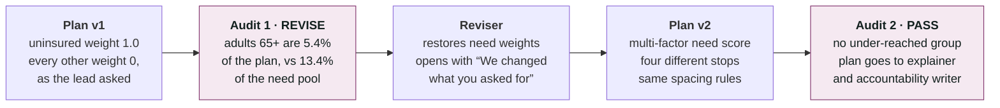
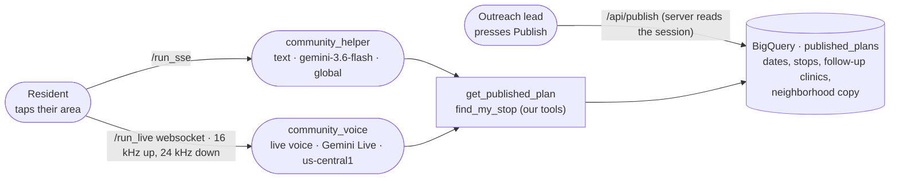
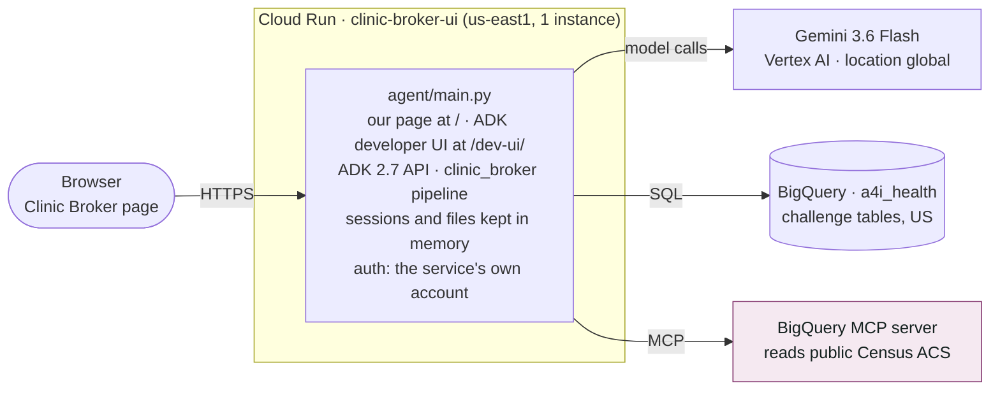

# Clinic Broker architecture

Six Gemini agents and five code steps decide where Fulton County's mobile clinic parks on
next month's four Saturdays, and two more (one for text, one for live voice) answer
residents' questions about the published plan. This page shows how they pass work to each
other, what each one is allowed to see, and where it all runs. The code is in
[`agent/clinic_broker/`](../agent/clinic_broker/); the full write-up is in
[`agent/README.md`](../agent/README.md).

## How the agents pass work

Edge labels are the `session.state` keys handed from one step to the next. Rounded boxes are
Gemini 3.6 Flash agents, square boxes are code steps with no model, and the pink zone is
the only part of the system that can read race and ethnicity.

```mermaid
flowchart LR
    lead(["Outreach lead<br/>asks for a plan"])

    subgraph evidence["PARALLEL · gather_evidence"]
        need["need_lookup<br/><i>tract scale</i>"]
        context["context_lookup<br/><i>12 km grid · 4-county region</i>"]
        capacity["capacity_lookup<br/><i>facility points</i>"]
        reviewer(["request_reviewer<br/>checks the request against the guidelines"])
    end

    planner(["planner<br/>picks 4 Saturdays"])

    subgraph loop["LOOP ≤ 3 ROUNDS · review_loop"]
        auditor(["auditor<br/>equity + evidence · PASS or REVISE"])
        reviser(["reviser<br/>need-based fixes only"])
    end

    subgraph outputs["PARALLEL · write_outputs"]
        explainer(["explainer<br/>EN + ES flyer copy"])
        writer(["accountability_writer<br/>funder statement"])
    end

    report["clinic_plan_report<br/>assembles, saves files"]
    files[/"Clinic Plan (chat) · flyers.html · accountability_statement.md"/]

    subgraph data["BigQuery · a4i_health"]
        tables[("burden · access · care sites<br/>exposure · disease<br/><b>no race or ethnicity</b>")]
    end

    subgraph auditorOnly["AUDITOR ONLY"]
        mcp["BigQuery MCP server<br/>Google-managed · read-only SQL"]
        census[("Census ACS 2016-2020<br/>race and ethnicity by tract")]
    end

    lead -->|request| evidence
    evidence -->|"evidence_* · request_review"| planner
    planner -->|plan_stops| auditor
    auditor -->|"REVISE · audit_report"| reviser
    reviser -->|"new plan_stops"| auditor
    auditor -->|"PASS · final plan"| outputs
    outputs -->|"outreach · accountability"| report
    report --> files

    evidence -->|fixed SQL| tables
    planner -->|"plan_saturdays · rank_tracts (our tools)"| tables
    auditor -->|execute_sql_readonly| mcp
    mcp -->|race and ethnicity| census

    classDef code stroke-dasharray: 5 4
    classDef audit fill:#f5e9f1,stroke:#84376f,color:#14211f
    class need,context,capacity,report code
    class auditor,census audit
    style auditorOnly fill:#f5e9f1,stroke:#84376f,stroke-dasharray: 6 5
```

The planner reaches data only through our two tools, which read the challenge tables and
nothing else. The auditor is the only agent holding the BigQuery MCP tool, so it alone can
join the plan to Census race and ethnicity. Its audit query also pulls age 65+, limited
English and disability from the challenge tables. It runs with no conversation history
(`include_contents="none"`), so it sees the plan but never the planner's reasoning.

## The run where it rejected its own plan

The cause was a data defect, not a demographic choice: the uninsured measure covers adults
18 to 64 only, so ranking on it alone pushes older neighborhoods down. The reviser may
change only need and access settings, never pick a tract by its racial makeup. A code
gate, `revise_if_rejected`, lets the reviser run only after a REVISE, at most twice, and the
loop always ends on an audit, so no plan ships unchecked.

## The community side

The outreach lead publishes a finished plan; residents then ask about it on `/community`,
by text or live voice. Only the resident-facing slice of the plan is published: no audit
table, no demographics.

Both helpers share one instruction: answer about the van (when, where, what it offers,
where else to go), never give medical advice, never ask for personal details, never describe
a neighborhood's illness rates or who lives there, and send emergencies to 911.

## Who sees what

| Agent | Challenge tables | Census race and ethnicity | Planner's reasoning | The plan | The audit |
|---|---|---|---|---|---|
| **Planner** | Yes, via our tools | No | Its own | Writes it | No |
| **Auditor** | In the audit query | **Yes** | No | Stops and text | Writes it |
| **Reviser** | Yes, via our tools | No | No | Yes, rewrites it | Yes |
| **Explainer** | No | No | No | Final stops only | No |
| **Accountability writer** | Computed facts | Audit's group shares only | No | Yes | Yes |
| **Community helper** (text, voice) | Clinic list only | No | No | Published slice only | No |

## Shared state

Every hand-off is a key in ADK's `session.state`, written by one step and read by another.
Parallel branches each write their own key, because branches share one state dictionary.

| Key | Written by | Read by |
|---|---|---|
| `evidence_need`, `evidence_context`, `evidence_capacity` | The three parallel lookups | Planner, reviser; accountability writer (county totals) |
| `request_review` | Request reviewer: verdict, guideline, message, settings | Planner and reviser (must follow its settings), the page's banner |
| `plan_stops` | `plan_saturdays` tool, called by the planner or reviser | Auditor (builds its Census query from it), explainer, accountability writer, report |
| `plan` | Planner, then reviser | Auditor, reviser, report |
| `need_pool_geo_ids` | `plan_saturdays` tool | Auditor (the comparison group) |
| `audit_report`, `audit_verdict` | Auditor | Reviser, loop control (PASS ends the loop), report |
| `audit_table` | Captured from the auditor's MCP call | Accountability writer |
| `outreach` | Explainer (structured English and Spanish copy) | Report, which renders `flyers.html` |
| `accountability` | Accountability writer | Report, which saves `accountability_statement.md` |

## Where it runs

The page and ADK's API are one server, so the page streams each agent's events from the
same address and needs no separate backend. Gemini 3.x answers only on the `global`
location in the lab project, so the service sets it explicitly. One instance, because
sessions and saved files live in memory and a second instance would not find them. The
original ADK-only deployment still runs as `clinic-broker`.

## The four questions judges ask

1. **Delete any one agent: does the answer get worse?** Without the auditor, the
   uninsured-only plan ships and under-reaches older adults. Without the explainer, the
   neighborhood gets a document written for professionals. Without the accountability
   writer, the funder gets an operational plan instead of an answer.
2. **A state key one agent writes and another reads:** `plan_stops`, written by the
   planner's tool and read by the auditor to build its Census query; `audit_report`,
   written by the auditor and read by the reviser.
3. **Two agents whose instructions conflict:** the planner must hedge, cite and label every
   number with its scale. The explainer must be warm and plain at a sixth-grade level, with
   no statistics and no hedging, in English and Spanish.
4. **Where the system rejected its first answer:** audit 1 on the uninsured-only plan,
   REVISE, because adults 65+ were 5.4% of the plan against 13.4% of the high-need tracts.
   The revised plan passed.
